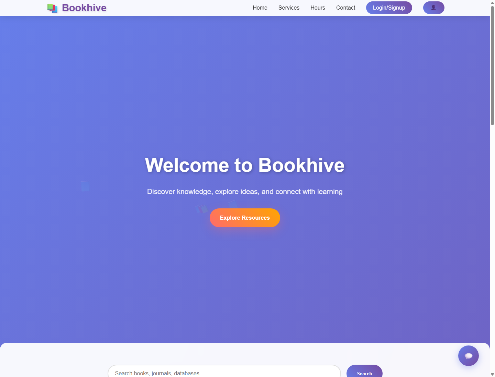
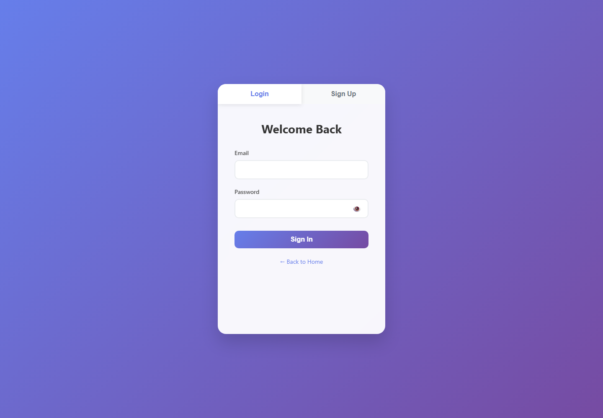
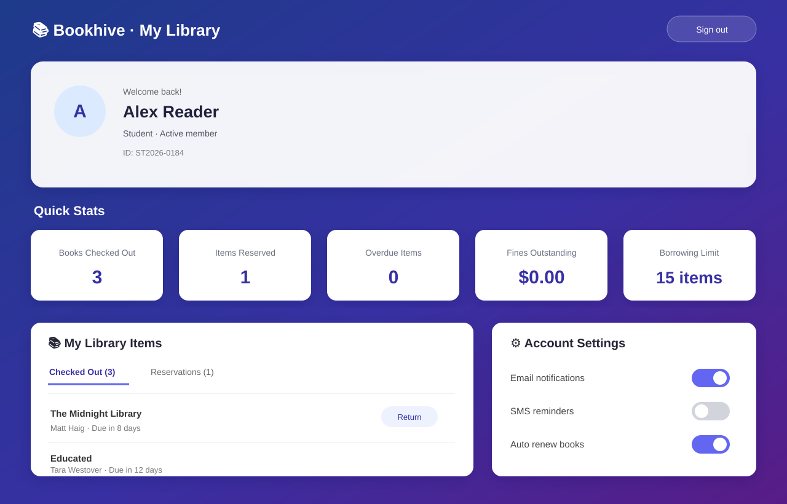

# Bookhive

Bookhive is a library website with a public home page, account registration and login, and a member profile for tracking library activity. The site is served by an Express backend, with MongoDB used for account and borrowing data.

## Interface previews

The home and login images are browser screenshots. The profile image is a static preview: the live profile page requires a signed-in account and redirects to login otherwise.

| Home page screenshot | Login screen screenshot |
| --- | --- |
|  |  |

| Member profile preview |
| --- |
|  |

## Features

- Library home page with service information, hours, and contact details
- Login and signup forms for students, graduate students, faculty, and staff
- JWT-based authentication and password hashing
- Member profile with checked-out books, reservations, borrowing history, fines, and account settings
- API routes for borrowing and returning books, profile data, and user settings

## Requirements

- Node.js 18 or newer
- npm
- MongoDB running locally or a MongoDB connection string

## Run locally

1. Install dependencies:

   ```bash
   npm install
   ```

2. (Optional) Create a `.env` file in the project root:

   ```dotenv
   MONGODB_URI=mongodb://localhost:27017/bookhive
   JWT_SECRET=replace-with-a-long-random-secret
   PORT=5000
   ```

   `MONGODB_URI` defaults to the local URL shown above, and `PORT` defaults to `5000`.

3. Start the server:

   ```bash
   npm start
   ```

4. Open [http://localhost:5000](http://localhost:5000). The app server serves the site from `public/`. If you use Live Server from the repository root, its `index.html` redirects to `public/index.html`.

For development with automatic restarts, run `npm run dev`.

## Pages

| Page | Path | Description |
| --- | --- | --- |
| Home | `/` | Library information and services |
| Login and signup | `/login.html` | Account access and registration |
| Member profile | `/library_profile-page.html` | Borrowed items, reservations, history, and settings |

## API

Authenticated endpoints expect `Authorization: Bearer <token>`.

| Method | Endpoint | Purpose |
| --- | --- | --- |
| `POST` | `/api/auth/signup` | Create an account |
| `POST` | `/api/auth/login` | Sign in and receive a token |
| `POST` | `/api/auth/logout` | End the client session |
| `GET` | `/api/user/profile` | Get profile and borrowing statistics |
| `PATCH` | `/api/user/settings` | Update notification and renewal settings |
| `POST` | `/api/user/borrow` | Add a book to the member's borrowed items |
| `POST` | `/api/user/return` | Return a borrowed book |

## Project structure

```text
bookhive/
├── public/
│   ├── index.html
│   ├── login.html
│   └── library_profile-page.html
├── docs/screenshots/       # Page screenshots and profile preview
├── index.html              # Redirect for root-based static servers
├── server.js               # Express app and API
├── package.json
└── .gitignore
```

## Configuration and security

The backend can read `MONGODB_URI`, `JWT_SECRET`, and `PORT` from `.env`. Keep `.env` out of version control; the repository ignores it. Set a private, random `JWT_SECRET` for any deployment beyond local development.

## License

No license is currently specified.
